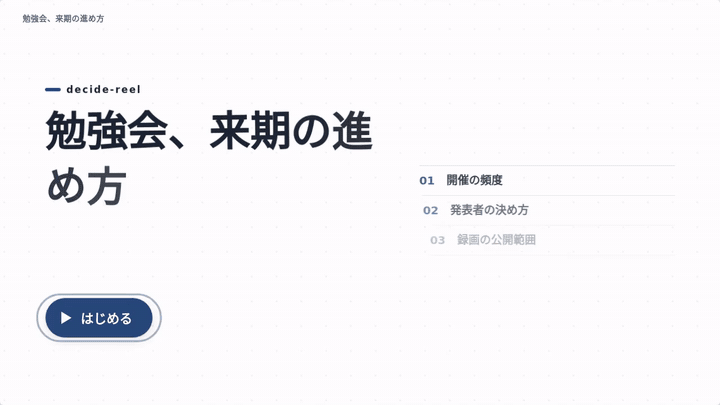
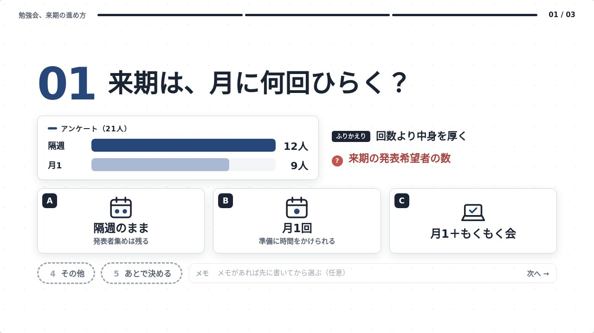
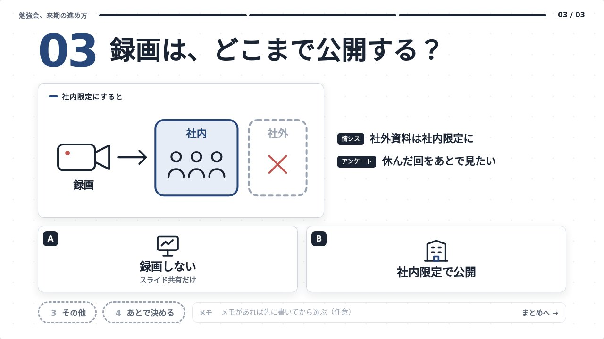
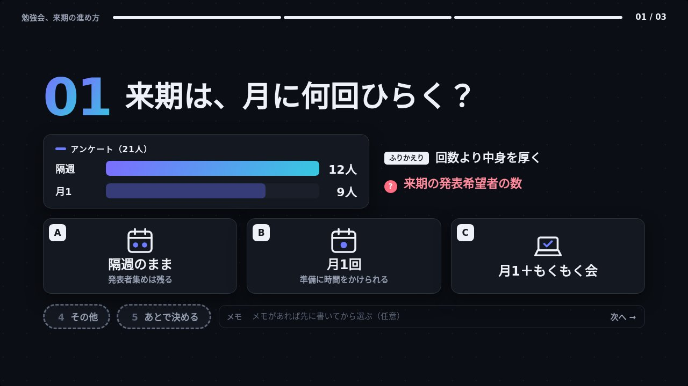
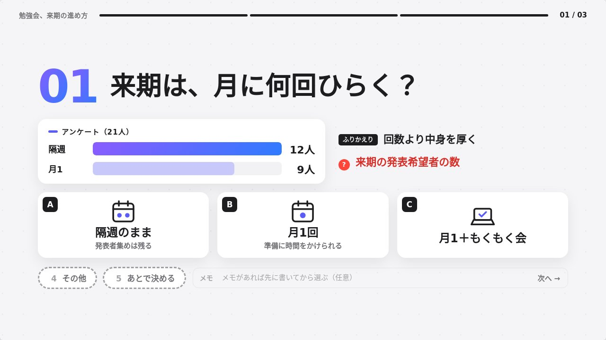
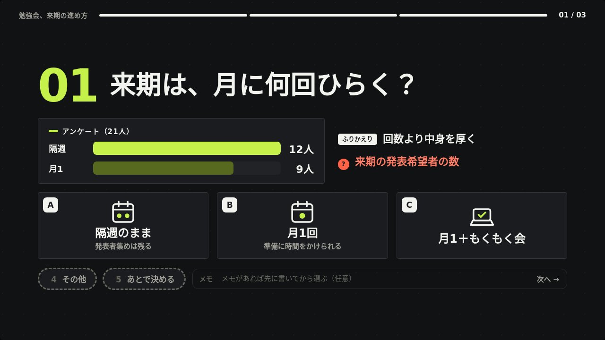
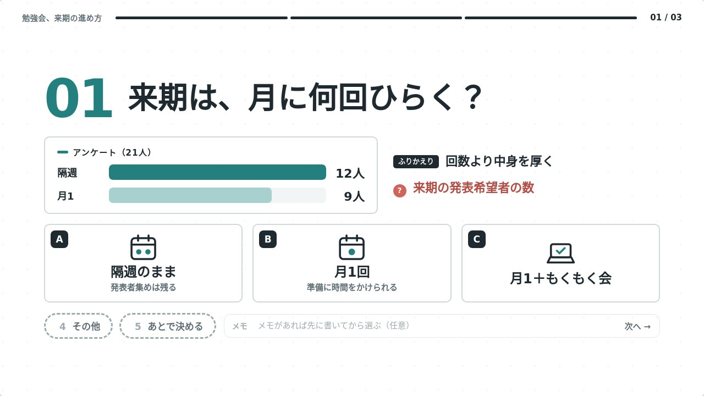
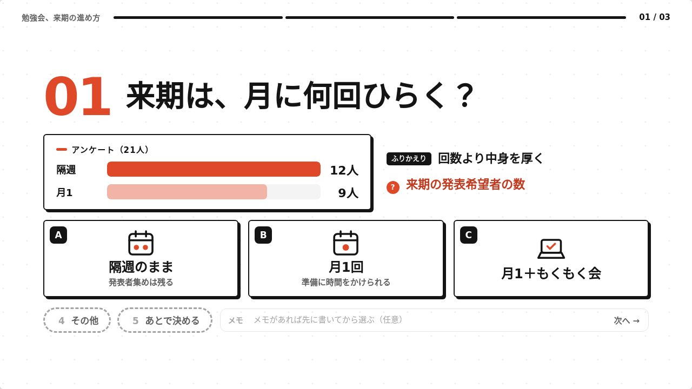
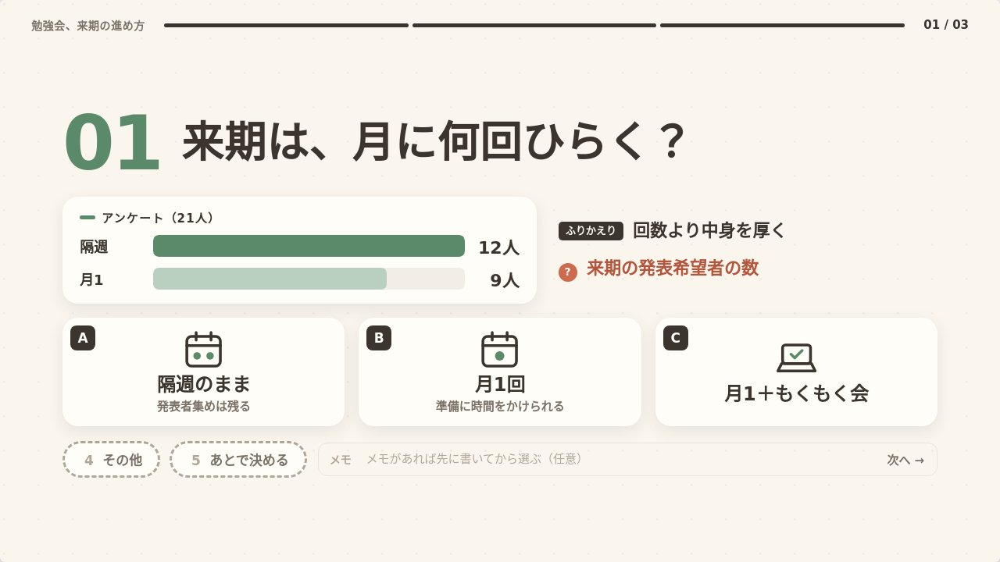
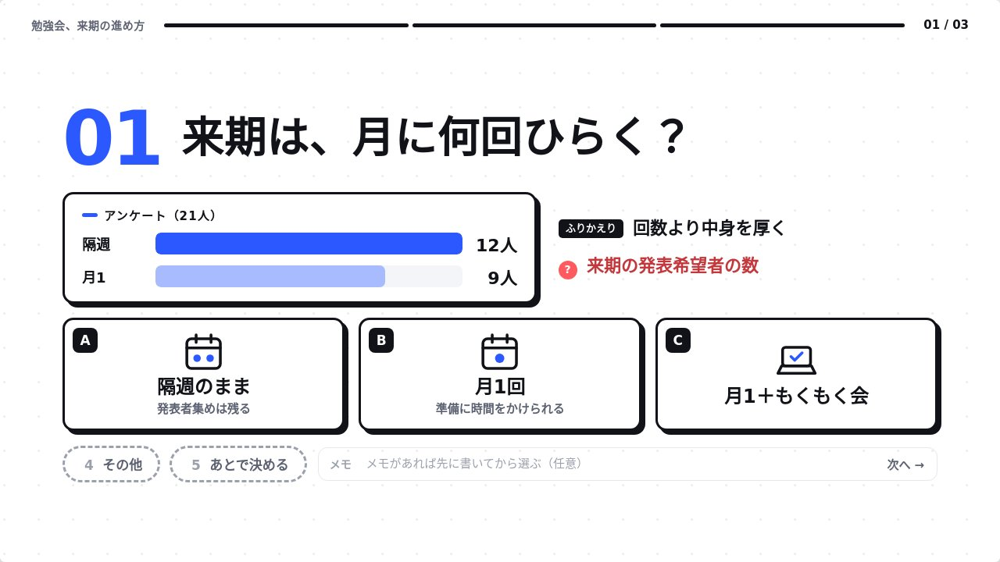

# decide-reel

MTGや確認で決めることが複数あるときに使う、Claude Code のスキルです。

**[▶ デモを触ってみる](https://qvtec.github.io/decide-reel/)**（ElevenLabs の声入り。「はじめる」を押すと音が出ます）



資料や議事録を渡すと、決めることを1件ずつ、1ページに **問い・図・短い材料** を動画風に出していき、選択肢が出たところで止まります。**A・B・C／その他／あとで決める** から選んでいき、最後に回答をまとめてコピーできます。

- ショーリール風のモーショングラフィックス。章ごとのワイプ、1文字ずつ飛び込む見出し、決めた瞬間の紙吹雪。効果音・ナレーション（ON/OFF）つき。見た目はテーマ8種から選べる（既定はネイビー）
- 文字は少なく、絵で見せる。数字は棒グラフ・円グラフ・大きな数字に、しくみや違いは論点ごとに描くSVGの説明図にし、選択肢にもSVGのアイコンを描く
- 1つの論点は1ページ。問い → 図と材料 → 選択肢 の順に出てくる。読み上げるのは問い・要点の一言・選択肢だけ
- 画面共有して、止まったところでみんなで決めて押す使い方を想定
- 論点（章）を自由に行き来できる。回答はブラウザに保存されるので、再読み込みしても消えない
- できるのはHTML1ファイル。外部への通信をしない（フォント・音・ライブラリなし）

 

## テーマ

JSONの `"theme"` で選びます（ページの中では T キーで切り替えて試せます）。

| | |
|---|---|
| <br>**`navy`**（既定）紺と金、やわらかい影 | <br>**`midnight`** 黒地に藍→シアンのグラデーション |
| <br>**`keynote`** 明るい地に紫→青のグラデーション、枠なし | <br>**`carbon`** 黒地にライム1色、角ばった線 |
| <br>**`slate`** グレーとティール、フラット | <br>**`mono`** 白黒に朱色1色 |
| <br>**`natural`** 生成りとセージグリーン、枠なし | <br>**`pop`** 青・黄・緑、太い黒枠 |

## インストール

### プラグインとして（おすすめ）

Claude Code で：

```
/plugin marketplace add qvtec/decide-reel
/plugin install decide-reel@decide-reel
```

### スキルのフォルダをコピーして

`plugins/decide-reel/skills/decide-reel` を `~/.claude/skills/decide-reel` にコピーします。

Python 3.8 以上が必要です（ページを組み立てるスクリプトに使います。追加のライブラリは不要）。

## 使い方

```
/decide-reel 来週の定例で決めること、この議事録とSlackのログから整理して
```

または、資料を渡して「決めることを1つずつ決めたい」「MTGの確認事項をページにして」と頼むだけでも動きます。

できたHTMLをブラウザで開き、「はじめる」を押します。

| キー | 操作 |
|---|---|
| Space | 再生／一時停止 |
| → | 選ぶ画面へ（選ぶ画面では次の論点へ） |
| ← | 前の論点 |
| 1〜5 | 選択肢を選んで次の論点へ（続く2つが「その他」「あとで決める」）。メモは先に書いておく |
| Enter | メモ欄で押すと次へ（「その他」のメモを書いたあとなど） |
| M / V / S / F | 目次／ナレーション／効果音／全画面 |
| T | テーマを順に切り替える（navy / pop / mono / natural / slate / midnight / carbon / keynote） |
| &lt; &gt; | 速さを変える（×0.8 / ×1 / ×1.25 / ×1.5。バーの「×1」を押しても回せる）。声と待ち時間が変わり、次に開いたときも同じ速さ |

まとめ画面の「回答をコピー」を押すと、こういう文になります。

```
【社内勉強会、来期の進め方】決めたこと（2026-11-05）

■ 決まったこと
1. 開催の頻度：C. 月1回＋もくもく会
2. 発表者の決め方：C. 立候補＋足りない回は指名
   メモ：指名は運営の2人で

■ あとで決めること
・録画の公開範囲（情シスに確認してから）
```

## JSONから直接作る

スキルを通さずに、JSONを書いてページだけ作ることもできます。形は [SKILL.md](plugins/decide-reel/skills/decide-reel/SKILL.md) と [サンプル](plugins/decide-reel/skills/decide-reel/examples/sample.json) を見てください。

```bash
python3 plugins/decide-reel/skills/decide-reel/scripts/build.py data.json out.html
```

## ナレーションについて

既定では、ブラウザの読み上げ機能（Web Speech API）を使います。声は Google の声 → Sayaka → Kyoko の順で見つかったものを使います（Chrome は Google、Windows の Edge は Sayaka、Mac の Safari は Kyoko）。下のバーのメニューで声を選べます（選んだ声は覚えておきます）。「オンライン」と付いた声は自然ですが、読み上げる文がブラウザの提供元に送られます。社外秘の内容を扱うときは、声をOFFにするか、JSONに `"narration": false` を入れてください。

### クラウドの声（Google Cloud TTS / ElevenLabs）

ビルドのときにクラウドの声で音声を作り、HTMLに埋め込めます。どの端末でも同じ自然な声になり、ページを開くときは外部への通信をしません。

まず、APIキーを `~/.config/decide-reel/env` に書いておきます。リポジトリの外なので、どのプロジェクトでスキルを使っても読み込まれ、誤ってコミットすることもありません。

```bash
mkdir -p ~/.config/decide-reel && chmod 700 ~/.config/decide-reel
cat > ~/.config/decide-reel/env <<'KEYS'
# Google Cloud TTS（なければ gcloud のログインを使う）
GOOGLE_TTS_API_KEY=...
# ElevenLabs（VOICE_ID は任意。なければ既製の声 Rachel）
ELEVENLABS_API_KEY=...
ELEVENLABS_VOICE_ID=...
KEYS
chmod 600 ~/.config/decide-reel/env
```

使うほうのキーだけ書けば大丈夫です。同じ名前の環境変数が設定されていれば、そちらが優先されます。あとは `--tts` を付けてビルドします。

```bash
python3 plugins/decide-reel/skills/decide-reel/scripts/build.py data.json out.html --tts gcloud
python3 plugins/decide-reel/skills/decide-reel/scripts/build.py data.json out.html --tts elevenlabs
```

ElevenLabs のモデルは既定で `eleven_v4` を使います（`"model"` で変えられます）。毎回指定する代わりに、JSONに `"tts": {"provider": "gcloud", "voice": "ja-JP-Neural2-B"}` と書くか、環境変数 `DECIDE_REEL_TTS=gcloud` を設定しておけます。

- 読み上げる文（問い・要点の一言・選択肢）は、ビルドのときに Google / ElevenLabs に送られます。社外秘の内容では使い分けてください
- 作った音声は `data.json` の隣の `.decide-reel-cache/` にとっておくので、同じ文は作り直しません（料金もかかりません）
- キーがない・通信できないときは、警告を出してブラウザの読み上げで動くページを作ります
- 3論点で音声14本・数百KBほど大きくなります。ページ下の声メニューで、ブラウザの声にも切り替えられます

## License

MIT
